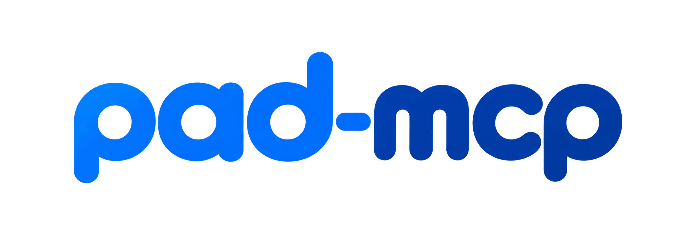

  

An MCP server for writing Power Automate Desktop flows using shared code snippets and action references.

Tell your agent what you want to automate. With **pad-mcp**, it can find the right actions and reuse your team's approved code snippets to generate Power Automate Desktop flows in both Classic and Power Fx.

> [!TIP]
> **Want a quick start?** Try the **public [pad-mcp-lite instance](https://github.com/ttiaMa/pad-mcp-lite#readme)** with action references only, but no server to set up.

## How it works

| Your team's knowledge | The action reference |
| --- | --- |
| Reusable PAD code snippets, step-by-step solutions and conventions you review and publish. | A searchable catalog of actions, parameters, examples and data types. |
| Stored in the SQLite database included with pad-mcp. The DB starts empty. | JSON catalogs from [PAD Robin Action Knowledge Base](https://github.com/JoeG592/pad-robin-action-kb), bundled with the application. |

At the start of the chat, the agent asks whether you use Classic PAD or Power Fx. That choice stays fixed throughout the conversation.

> Use pad-mcp with Power Fx enabled to read orders from Excel and save them as CSV files with 100 orders each.

The agent produces **Robin, the scripting language behind PAD flows**. Copy the generated code and paste it into the PAD flow designer to turn it into actions, then review and test the flow.

## Roles and access

**Developers** use published snippets and action references to build PAD flows. **Maintainers** can do the same, plus create and edit snippets, review drafts, publish updates and manage revision history.

Set the Maintainer API key through the `MCP_MAINTAINER_TOKEN` environment variable. Create, list or delete individual Developer API keys from the server terminal. See [API key management](docs/api-keys.md) for instructions.

## Get started

Use a [release tag](https://github.com/ttiaMa/pad-mcp/releases) for a fixed version, the `latest` branch to follow stable releases, or `main` to follow development. All use the same installation methods.

- [Install with Docker Compose or Node.js and connect your agent](docs/setup.md)
- [Use the tools and publish snippets](docs/usage.md)
- [Upgrade, back up and restore your data](docs/deployment.md)
- [Read the prompts: shared](src/prompts/common.md) · [Classic](src/prompts/classic.md) · [Power Fx](src/prompts/power-fx.md)

## Credits

The action/type catalogs come from **[JoeG592's PAD Robin Action Knowledge Base](https://github.com/JoeG592/pad-robin-action-kb)**. Thank you for making this reference available.

---

Code licensed under [MIT](LICENSE). Third-party materials retain their respective licenses.
