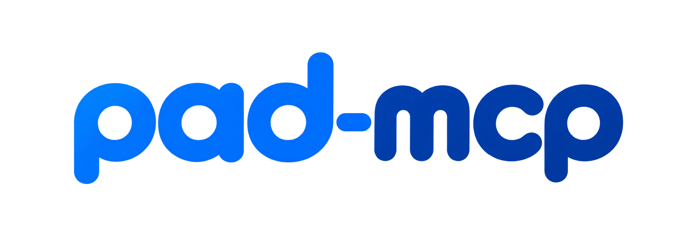

  

**An MCP server for writing Power Automate Desktop flows using shared code snippets and action references.**

Describe what you need to automate to build a new flow, or **paste code or process logic from Blue Prism, UiPath or another RPA tool** and ask the agent to rebuild that task in PAD using your team's coding conventions. Supports **Classic PAD and Power Fx**.

## How it works

| Your team's knowledge | The action reference |
| --- | --- |
| Reusable PAD code snippets, step-by-step solutions and conventions you review and publish. | A searchable catalog of actions, parameters, examples and data types. |
| Stored in the SQLite database included with pad-mcp. | JSON catalogs from [PAD Robin Action Knowledge Base](https://github.com/JoeG592/pad-robin-action-kb), bundled with the application. |

At the start of the chat, the agent asks whether you use Classic PAD or Power Fx. That choice stays fixed throughout the conversation.

> Use pad-mcp to read orders from Excel and save them as CSV files with 100 orders each.

> Use pad-mcp to recreate this task in Power Automate Desktop with Power Fx enabled. [Copied code]

The agent produces **Robin, the scripting language behind PAD flows**. Copy the generated code and paste it into the PAD flow designer to turn it into actions, then review and test the flow.

## Roles and access

**Developers** use published snippets and action references to build PAD flows. **Maintainers** can do the same, plus create and edit snippets, review drafts, publish updates and manage revision history.

Set the Maintainer API key through the `MCP_MAINTAINER_TOKEN` environment variable. Create, list or delete individual Developer API keys from the server terminal. See [API key management](docs/api-keys.md) for instructions.

## Get started

Use [release v1.0.0](https://github.com/ttiaMa/pad-mcp/releases/tag/v1.0.0) for a fixed version, or `main` to follow development. Both support the same installation methods.

- [Install with Docker Compose or Node.js and connect your agent](docs/setup.md)
- [Use the tools and publish snippets](docs/usage.md)
- [Upgrade, back up and restore your data](docs/deployment.md)
- [Read the prompts: shared](src/prompts/common.md) · [Classic](src/prompts/classic.md) · [Power Fx](src/prompts/power-fx.md)

## Credits

The action/type catalogs come from **[JoeG592's PAD Robin Action Knowledge Base](https://github.com/JoeG592/pad-robin-action-kb)**. Thank you for making this reference available.

Catalog examples validated by pasting into PAD are useful references; they do not prove that a newly composed flow will run correctly.

---

Code licensed under [MIT](LICENSE). Third-party materials retain their respective licenses.
